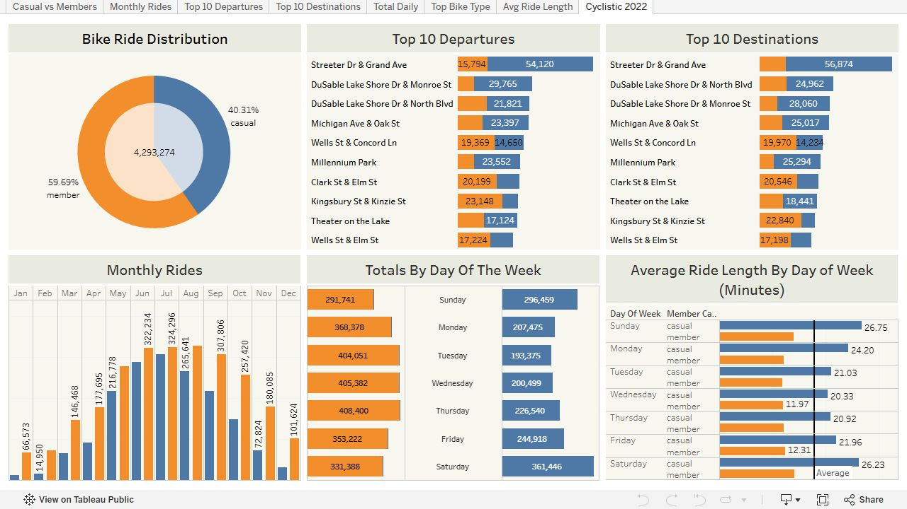

# Cyclistic Bike-Share Analysis

> Exploratory analysis of 4.29M cleaned rides (2022 Divvy data) examining member vs. casual usage patterns to design targeted membership conversion strategies.

[](scripts/cyclistic_analysis.R)
[](sql/bigquery_exploratory_analysis.sql)
[](https://public.tableau.com/app/profile/jonathan8167/viz/2022CyclisticData/Cyclistic2022)
[](LICENSE)

---

## Project Overview

Cyclistic operates a bike-share network of over 5,800 geotracked bicycles across 692 stations in Chicago. The service offers flexible pricing options, including single-ride passes, full-day passes, and annual memberships. Finance team analytics indicate that annual members are significantly more profitable than casual riders.

This case study investigates how annual members and casual riders use the service differently, analyzing **4,293,274 cleaned rides from calendar year 2022**. The goal is to provide data-backed recommendations for a targeted marketing campaign to convert casual riders into annual members.

| Resource | Link | Description |
| :--- | :--- | :--- |
| **Interactive Dashboard** | [Tableau Public Dashboard](https://public.tableau.com/app/profile/jonathan8167/viz/2022CyclisticData/Cyclistic2022) | Full visual dashboard comparing volume, weekday cadence, duration, and station geography |
| **Kaggle Notebook** | [Kaggle Analysis](https://www.kaggle.com/code/jonathanabuelouf/cyclistic-ride-share-analysis) | Reproducible 86-cell R notebook with exploratory charts |
| **Local R Pipeline** | [`scripts/cyclistic_analysis.R`](scripts/cyclistic_analysis.R) | End-to-end data preparation, boundary cleaning, and summary script |
| **BigQuery SQL** | [`sql/bigquery_exploratory_analysis.sql`](sql/bigquery_exploratory_analysis.sql) | SQL validation, quantile duration benchmarks, and station rankings |

---

## Executive Summary & Campaign Hypotheses

Rather than treating the entire year as a single average, the analysis separates volume, ride duration, weekly patterns, and seasonality. The findings establish clear behavioral differences between rider groups, translated into testable campaign hypotheses:

| Observed Behavior | Proposed Marketing Action | What a Pilot Test Needs to Establish |
| :--- | :--- | :--- |
| **Casual activity surges May through September** | Launch seasonal membership promotions or summer commuter passes | Whether seasonal introductory pricing drives subscriptions that retain into year two |
| **Casual volume peaks Friday through Sunday** | In-app weekend rewards and points for repeat rides | Whether gamified point incentives change repeat riding cadence and lift conversion |
| **Casuals ride 2x longer; members ride regularly on weekdays** | Targeted digital and transit campaigns highlighting commuter savings | Whether messaging tailored to regular short trips resonates with frequent casual riders |

---

## Data Cleaning & Transformation Pipeline

The raw dataset comprises twelve monthly trip CSV files published by Divvy (City of Chicago / Motivate International Inc.) for 2022. 

```
Raw Monthly CSVs (12 files)
       │
       ▼
Schema Normalization (Fix November timestamp formatting to POSIXct)
       │
       ▼
Data Integration & Feature Extraction (date, month, day_of_week, ride_length_sec)
       │
       ▼
Quality Filtering:
  ├─ Remove negative durations (clock skew / docking glitch)
  ├─ Drop records with missing station or timestamp values
  └─ Trim boundaries: exclude trips < 60s (docking aborts) & > 54,000s (15 hrs, lost bikes)
       │
       ▼
Clean Working Dataset: 4,293,274 Rides
  ├─ Annual Members: 2,562,562 rides (59.7%)
  └─ Casual Riders:  1,730,712 rides (40.3%)
```

### Cleaning Implementation Details

1. **Schema Correction:** November trip records used a non-standard `%m/%d/%Y %H:%M` datetime string format while other months conformed to standard ISO datetime. Timestamps were explicitly converted to POSIXct before merging.
2. **Boundary Trimming:** Trips under 60 seconds were omitted to remove false starts and dock-recheck events. Trips exceeding 54,000 seconds (15 hours) were removed to exclude unreturned or stolen bicycles.
3. **Derived Fields:** Derived date, year, month, and day-of-week fields, along with `ride_length` in seconds.

---

## Key Analytical Findings

### 1. Trip Volume vs. Ride Length

* **Volume:** Annual members account for the majority of completed trips (59.7% vs. 40.3%).
* **Duration:** Casual riders stay on bikes substantially longer across all days of the week, averaging approximately double the trip duration of annual members. Members exhibit tightly clustered, consistent trip lengths indicative of routine transit.



### 2. Day of Week Patterns

* **Members:** Peak ridership occurs Monday through Friday during morning (7:00 to 9:00 AM) and evening (4:30 to 6:30 PM) commute hours.
* **Casual Riders:** Activity shifts heavily toward Friday, Saturday, and Sunday, peaking during midday hours.

### 3. Geographic & Station Footprint

* **Casual Riders:** Concentrated heavily along lakefront recreational paths, parks, and tourist landmarks (e.g., Streeter Dr & Grand Ave, Millennium Park, Michigan Ave & Oak St).
* **Members:** Concentrated around commercial transit hubs, subway transfer points, and residential neighborhoods (e.g., Kingsbury St & Kinzie St, Clinton St & Madison St).

---

## BigQuery SQL Exploration Sample

Below is an excerpt from [`sql/bigquery_exploratory_analysis.sql`](sql/bigquery_exploratory_analysis.sql) showing the boundary-filtered aggregation across user segments:

```sql
WITH cleaned_rides AS (
  SELECT
    ride_id,
    member_casual,
    TIMESTAMP_DIFF(ended_at, started_at, SECOND) AS ride_length_seconds,
    EXTRACT(DAYOFWEEK FROM started_at) AS day_of_week_num,
    FORMAT_DATE('%A', DATE(started_at)) AS day_of_week_name
  FROM
    `cyclistic_data.combined_2022_trips`
  WHERE
    started_at IS NOT NULL
    AND ended_at IS NOT NULL
    AND start_station_name IS NOT NULL
    AND end_station_name IS NOT NULL
    AND TIMESTAMP_DIFF(ended_at, started_at, SECOND) >= 60
    AND TIMESTAMP_DIFF(ended_at, started_at, SECOND) <= 54000
)
SELECT
  member_casual,
  COUNT(ride_id) AS total_rides,
  ROUND(COUNT(ride_id) * 100.0 / SUM(COUNT(ride_id)) OVER(), 2) AS ride_share_pct,
  ROUND(AVG(ride_length_seconds) / 60.0, 2) AS avg_duration_minutes,
  ROUND(APPROX_QUANTILES(ride_length_seconds, 2)[OFFSET(1)] / 60.0, 2) AS median_duration_minutes
FROM
  cleaned_rides
GROUP BY
  member_casual;
```

---

## Repository Structure

```
cyclistic-bike-share-analysis/
├── .gitignore                          # Excludes raw data CSVs and R environment files
├── LICENSE                             # MIT License
├── README.md                           # Project documentation and summary
├── images/
│   └── cyclistic-dashboard.png         # Tableau dashboard overview
├── notebooks/
│   └── cyclistic_ride_share_analysis.ipynb # Complete 86-cell R notebook
├── scripts/
│   └── cyclistic_analysis.R            # Standalone R pipeline script
└── sql/
    └── bigquery_exploratory_analysis.sql # BigQuery validation and EDA queries
```

---

## Reproduction & Setup

### Option A: Running R Scripts Locally

1. Clone this repository:
   ```bash
   git clone https://github.com/Jabuelouf/cyclistic-bike-share-analysis.git
   cd cyclistic-bike-share-analysis
   ```
2. Download the 2022 monthly Divvy trip data CSVs and place them in a `data/` subfolder.
3. Open R / RStudio and install dependencies:
   ```r
   install.packages(c("tidyverse", "lubridate", "dplyr", "ggplot2", "plotly"))
   ```
4. Execute the pipeline:
   ```r
   source("scripts/cyclistic_analysis.R")
   ```

### Option B: Kaggle Environment

The full notebook can be viewed and run directly on [Kaggle](https://www.kaggle.com/code/jonathanabuelouf/cyclistic-ride-share-analysis) against the public Divvy 2022 dataset without manual file downloads.

---

## Limitations & Scope

* **Observational Trip Data:** The records document observed trip timestamps, durations, and stations. They do not record user demographics, price elasticity, or individual rider identity.
* **Unmeasured Motivation:** While recreational and commuting patterns are inferred from station locations and timestamps, direct rider intent cannot be verified from trip logs alone.
* **Hypotheses vs. Realized Outcomes:** Proposed campaigns (seasonal passes, loyalty reward challenges) are structured hypotheses that require A/B testing via controlled pilots before full rollout.
